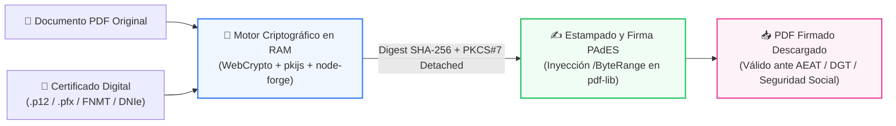

# FirmarPDFCertificado.com 🇪🇸

<div align="center">

> **El firmador de PDF con certificado digital en el navegador más rápido, privado y gratuito de España.**  
> Firma tus documentos con certificado FNMT, DNIe o cualquier archivo `.p12` / `.pfx` sin instalar AutoFirma, sin Java y 100% en local.

[](https://firmarpdfcertificado.com)
[-brightgreen?style=for-the-badge)](https://firmarpdfcertificado.com)
[](https://firmarpdfcertificado.com)
[](https://firmarpdfcertificado.com)

<br/>

👉 **Acceder a la Herramienta:** [**https://firmarpdfcertificado.com**](https://firmarpdfcertificado.com)

</div>

---

## ⚡ Flujo Criptográfico en el Navegador (Zero-Knowledge Pipeline)

A diferencia de las plataformas tradicionales que suben tus documentos a servidores remotos, **FirmarPDFCertificado.com** procesa la firma mediante la Web Crypto API y Web Workers directamente en la memoria RAM de tu dispositivo:



---

## 🥊 Comparativa: ¿Por qué FirmarPDFCertificado?

| Característica | AutoFirma (Aplicación Oficial) | Firmadores en la Nube (SaaS) | FirmarPDFCertificado.com |
| :--- | :---: | :---: | :---: |
| **Privacidad de Documentos** | Local en tu PC | ❌ Sube tus PDFs a servidores externos | **✅ 100% en RAM local (Zero-Upload)** |
| **Protección Clave Privada** | Almacén del SO | ❌ Riesgo de filtración en la red | **✅ La clave privada jamás sale de tu navegador** |
| **Instalación de Software** | ⚠️ Requiere Java y permisos de administrador | Ninguna | **✅ Cero instalación (Funciona en el navegador)** |
| **Compatibilidad Móvil** | ❌ No compatible con iOS/Android | Sí | **✅ iPhone, Android, Mac, Windows, Linux** |
| **Validez Jurídica** | PAdES Oficial | Variable / Simple | **✅ PAdES-B-B (ETSI EN 319 142-1)** |
| **Precio / Límites** | Gratuito | Planes de pago / Límite de firmas | **✅ 100% Gratuito y sin límites de uso** |

---

## 🚀 Características Principales

- **100% en el Navegador (RAM & Web Workers):** Ni el archivo PDF ni la clave privada de tu certificado digital salen jamás de tu dispositivo. Cumplimiento estricto con el **RGPD** y el **Reglamento eIDAS (UE 910/2014)**.
- **Validez Legal Plena:** Genera firmas criptográficas avanzadas **PAdES-B-B (ETSI EN 319 142-1)** válidas ante la Agencia Tributaria (AEAT), Seguridad Social, DGT, Registro Mercantil y juzgados.
- **Sin AutoFirma ni Java:** Olvídate de dependencias pesadas, bloqueos de puertos locales y errores típicos de configuración en macOS y Windows.
- **Validador Criptográfico Integrado:** Inspecciona y verifica firmas existentes en cualquier PDF con lectura de metadatos X.509 (NIF/NIE del emisor, fecha de firma, integridad de bytes y autoridad de certificación emisora).
- **Multiplataforma:** Compatible con todos los navegadores modernos (Chrome, Safari, Firefox, Edge en Windows, macOS, Linux, iOS y Android).
- **21 Páginas y Guías Especializadas:** Arquitectura con guías paso a paso sobre exportación de certificados FNMT, DNIe, co-firmas múltiples, normativa Veri*factu y resolución de incidencias telemáticas.

---

## 📁 Tipos de Certificados Compatibles

```text
┌────────────────────────────────────────────────────────────────────────┐
│                     CERTIFICADOS DIGITALES COMPATIBLES                 │
├────────────────────────────┬───────────────────────────────────────────┤
│ FNMT-RCM                   │ Personas Físicas, Representante, Empleado │
│ DNI Electrónico (DNIe)     │ Exportación PKCS#12 (.p12 / .pfx)         │
│ Camerfirma                 │ Certificados corporativos y cualificados  │
│ Izenpe / ACCV / CATCert    │ Autoridades de Certificación Autonómicas  │
│ Formatos Criptográficos    │ Claves RSA 2048/4096-bit con SHA-256      │
└────────────────────────────┴───────────────────────────────────────────┘
```

---

## 🔒 Privacidad y Seguridad Garantizada

1. **Arquitectura Zero-Knowledge:** El procesamiento criptográfico y la manipulación del árbol binario del PDF ocurren exclusivamente dentro de un Web Worker en la memoria de tu dispositivo.
2. **Sin Servidores Intermedios:** Ningún byte de tus documentos ni de tus certificados se transfiere a ningún servidor externo.
3. **Cabeceras de Seguridad Extremas:** Desplegado con políticas estrictas de Content Security Policy (`CSP`), HSTS, `X-Content-Type-Options: nosniff` y `X-Frame-Options: SAMEORIGIN`.

---

## 📄 Licencia

© [FirmarPDFCertificado.com](https://firmarpdfcertificado.com) — Todos los derechos reservados.
